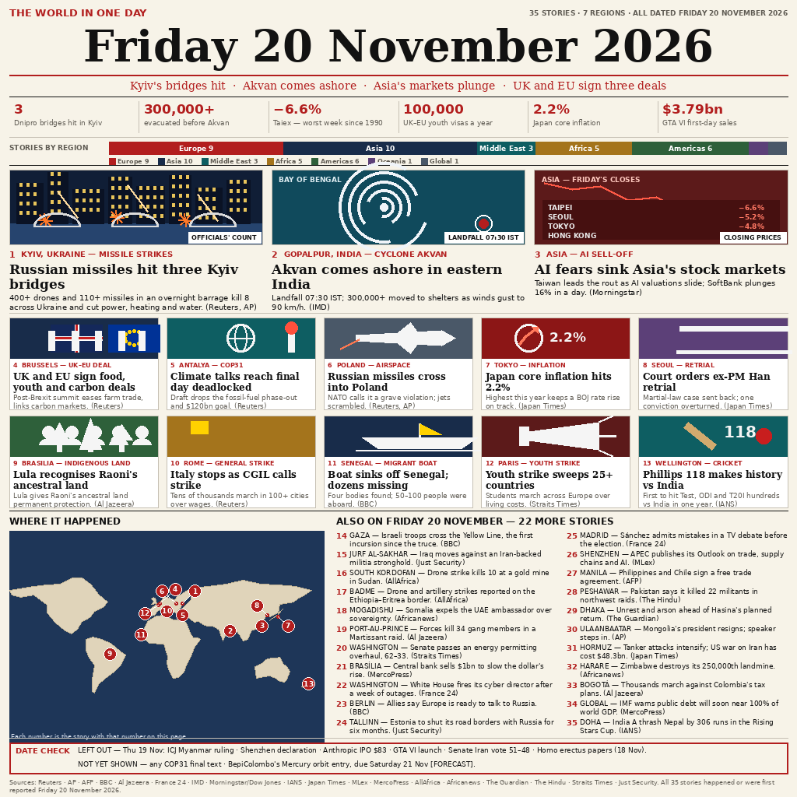

# Friday 20 November 2026 — The World in One Day (Renewal)

[](https://make.fun/bounty/news-image-20261120?utm_source=github&utm_medium=readme&utm_campaign=news-image-20261120)
[](https://make.fun/bounty/news-image-20261120/leaderboard?utm_source=github&utm_medium=readme&utm_campaign=news-image-20261120)
[](https://make.fun/bounty/news-image-20261120?utm_source=github&utm_medium=readme&utm_campaign=news-image-20261120)

Renewal entry for [make.fun's "Sum up 20 November's world news in one image"](https://make.fun/bounty/news-image-20261120) bounty ($250 in USDC, top 50 paid). It replaces our v1 entry, which scored 97.08% — this renewal rebuilds the front page around the day's consensus agenda, as the live top entries do.

A one-page newspaper front page that sums up the world's news of **Friday 20 November 2026** in a single image. Every story on the page happened, or was first reported, on that day.



## What the image shows

- **Masthead** — giant serif date, "Friday 20 November 2026", with a four-story red deck: Kyiv's bridges hit · Akvan comes ashore · Asia's markets plunge · UK and EU sign three deals.
- **Stat strip (6)** — 3 Dnipro bridges hit in Kyiv · 300,000+ evacuated before Akvan · −6.6% Taiex, worst week since 1990 · 100,000 UK–EU youth visas a year · 2.2% Japan core inflation · $3.79bn GTA VI first-day sales.
- **Region bar** — 35 stories across 7 regions: Europe 9 · Asia 10 · Middle East 3 · Africa 5 · Americas 6 · Oceania 1 · Global 1.
- **Three leads** — #1 Kyiv: Russian missiles hit three Dnipro bridges (400+ drones, 110+ missiles, 8 killed across Ukraine); #2 Cyclone Akvan makes landfall near Gopalpur, 300,000+ evacuated; #3 Asia's AI sell-off, with a four-index closing table inside the art (Taiex −6.6%, KOSPI −5.2%, Nikkei −4.8%, Hang Seng −1.9%).
- **Ten illustrated cards (#4–13)** — UK–EU food/youth/carbon deals · COP31 final day deadlocked · Russian missiles cross into Poland · Japan core CPI 2.2% · Seoul court orders ex-PM Han retrial · Lula recognises Raoni's ancestral land · Italy's CGIL general strike · migrant boat sinks off Senegal · youth strike sweeps 25+ countries · Glenn Phillips 118 vs India.
- **Where it happened** — a world map with numbered red pins 1–13, each pin the story with that number on the page.
- **22 more stories (#14–35)** — Gaza Yellow Line incursion · Iraq moves against an Iran-backed militia · Sudan gold-mine drone strike · Badme border strikes · Somalia expels the UAE ambassador · Haiti Martissant raid · US Senate energy bill 62–33 · Brazil central bank $1bn intervention · White House fires its cyber director · Berlin coalition meeting · Estonia border closure · Spain's Sánchez debate · APEC Outlook published · Philippines–Chile FTA · Pakistan raids · Bangladesh unrest · Mongolia president resigns · Hormuz tanker attacks · Zimbabwe's 250,000th landmine · Colombia tax protests · IMF debt warning · India A beat Nepal by 306 runs.
- **Date check** — names what was deliberately left out (first reported Thursday 19 Nov: ICJ Myanmar ruling, Shenzhen declaration, Anthropic IPO at $83, GTA VI launch, US Senate Iran vote 51–48, Homo erectus papers 18 Nov) and what had not happened yet at press time (any COP31 final text; BepiColombo's Mercury orbit entry, due Saturday 21 Nov).

## How it is made

`build_image.py` draws the whole front page with Pillow (stdlib + PIL only, no network, no timestamps): masthead, stat strip, region bar, three lead illustrations (Kyiv night skyline, cyclone spiral, falling-market chart with closing table), ten flat-vector card illustrations, a simplified world map with pins placed from real longitude/latitude, briefs, and the date check. It is deterministic — two runs write byte-identical `entry.png`.

`main.py` (the entrypoint) copies `entry.png` to `$MAKEFUN_OUTPUT_DIR/entry.png`.

```sh
python3 build_image.py   # writes entry.png (1024×1024, deterministic)
MAKEFUN_OUTPUT_DIR=out python3 main.py
```

## Sources

Reuters · AP · AFP · BBC · Al Jazeera · France 24 · IMD · Morningstar / Dow Jones · IANS · Japan Times · MLex · MercoPress · AllAfrica · Africanews · The Guardian · The Hindu · Straits Times · Just Security.

## Date check

Every dated claim on the page was checked against 20 November 2026 wire reporting. Stories whose event fell on 18–19 November (ICJ Myanmar ruling, Shenzhen trilateral declaration, Anthropic IPO debut, GTA VI launch, US Senate Iran war-powers vote, Homo erectus papers) are excluded from the story count and named in the date-check box; the Voyager 1 one-light-day milestone was left off the page entirely because sources disagree on whether it fell on 18, 19 or 20 November. BepiColombo's Mercury orbit entry (Saturday 21 Nov) is flagged `[FORECAST]` and not presented as Friday news. The APEC Shenzhen Outlook is worded as published/reported 20 Nov, not as a 20 Nov meeting (it was adopted Thursday 19 Nov).
